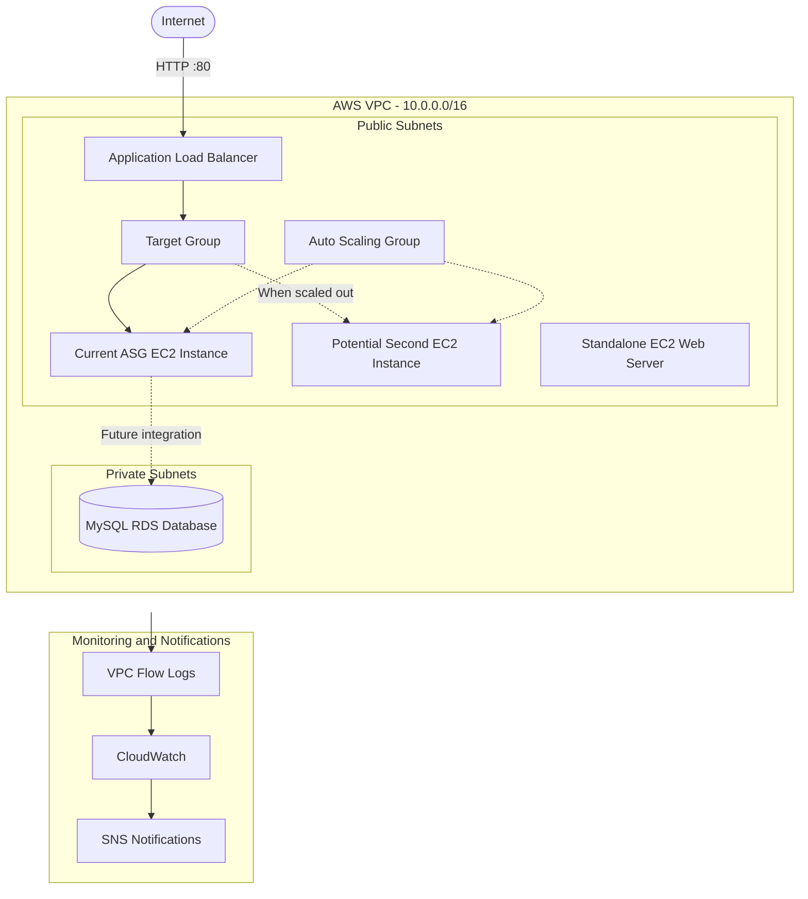

# Terraform AWS Infrastructure Automation

A modular Infrastructure as Code (IaC) project that provisions and manages AWS infrastructure using Terraform. This project demonstrates AWS networking, compute, load balancing, auto scaling, database provisioning, security hardening, remote state management, and automated CI validation.

## Overview

This project demonstrates how to design and manage a multi-tier AWS infrastructure using reusable Terraform modules.

The infrastructure includes:

- Custom AWS VPC with public and private subnets across two Availability Zones.
- Internet Gateway and separate routing configurations.
- Application Load Balancer (ALB).
- EC2 Auto Scaling Group (ASG) with launch template and target tracking.
- Existing standalone EC2 web server.
- Private MySQL RDS database.
- VPC Flow Logs and CloudWatch monitoring.
- SNS notifications for monitoring alerts.
- S3 remote Terraform state with encryption, versioning, and lockfile-based locking.
- GitHub Actions CI for Terraform validation and Checkov security scanning.

The project prioritizes security, infrastructure reliability, modularity, and cost-conscious AWS resource selection.

## Architecture


**Current architecture notes:**

- The public ALB distributes HTTP traffic to the Auto Scaling application instances.
- The ASG currently maintains one desired EC2 instance and can scale up to two.
- A separate standalone EC2 web server is preserved.
- The MySQL RDS database is provisioned in private subnets but is not yet connected to the application.
- The private subnets do not use a NAT Gateway.
- ASG instances currently use public IP addresses for outbound access without a NAT Gateway.
- HTTPS, WAF, and NAT-based private outbound connectivity are not currently implemented.

## Technologies Used

- Terraform
- Amazon Web Services (AWS)
- Amazon VPC
- Amazon EC2
- Application Load Balancer
- Auto Scaling Groups
- Amazon RDS (MySQL)
- AWS IAM
- AWS Security Groups
- Amazon S3
- Amazon CloudWatch
- Amazon SNS
- AWS CLI
- Git and GitHub
- GitHub Actions
- Checkov
- Windows PowerShell

## Project Structure

```text
terraform-aws-infrastructure-automation/
|
|-- .github/
|   `-- workflows/
|       `-- terraform-ci.yml
|
|-- modules/
|   |-- network/
|   |-- security/
|   |-- compute/
|   |-- load_balancer/
|   |-- autoscaling/
|   `-- database/
|
|-- docs/
|-- screenshots/
|
|-- .gitignore
|-- .terraform.lock.hcl
|-- main.tf
|-- outputs.tf
|-- providers.tf
|-- variables.tf
|-- versions.tf
|-- terraform.tfvars.example
`-- README.md
```

## Infrastructure Components

### 1. Networking Module

Manages:

- Custom VPC (`10.0.0.0/16`).
- Two public subnets.
- Two private subnets.
- Internet Gateway.
- Public and private route tables.
- Route table associations.
- VPC Flow Logs.

### 2. Security Module

Manages the security group for the existing standalone web server.

Security configuration:

- Inbound HTTP traffic on port 80.
- Outbound HTTPS traffic on port 443.
- VPC association.
- Resource tagging.

### 3. Compute Module

Provisions the existing standalone EC2 web server.

Configuration includes:

- Amazon Linux 2023.
- t3.micro instance type.
- Encrypted gp3 root EBS volume.
- EC2 instance profile for Systems Manager access.
- IMDSv2 required.
- Apache web server installation through the original user data configuration.

The existing EC2 instance and its user data are preserved.

### 4. Load Balancer Module

Provisions an internet-facing Application Load Balancer.

Security and configuration controls:

- Public subnet placement.
- HTTP listener on port 80.
- Target group using HTTP port 80.
- Deletion protection enabled.
- Invalid HTTP header fields dropped.
- ALB security group ingress restricted to the intended public HTTP service.
- ALB security group egress restricted to application traffic within the VPC.

HTTPS is a future improvement requiring a domain and an ACM certificate.

### 5. Auto Scaling Module

Manages:

- EC2 launch template.
- Auto Scaling Group.
- Application security group.
- Load balancer target group attachment.
- ELB health checks.
- CPU-based target tracking scaling policy.
- CloudWatch CPU alarm.
- SNS email notifications.

Current scaling configuration:

| Setting | Value |
|---|---:|
| Minimum capacity | 1 |
| Desired capacity | 1 |
| Maximum capacity | 2 |
| Instance type | t3.micro |
| CPU target tracking | 50% |

Application instances accept HTTP traffic from the ALB security group rather than directly from the public internet.

### 6. Database Module

Provisions a private Amazon RDS MySQL database.

Configuration:

- db.t3.micro instance class.
- 20 GB gp3 storage.
- Storage encryption enabled.
- Private subnet placement.
- Public accessibility disabled.
- One-day backup retention.
- AWS-managed master password.
- Deletion protection enabled.
- Final snapshot required.

The database is provisioned but application integration is planned for a future stage.

## Remote Terraform State

Terraform state is stored in an Amazon S3 backend.

Configuration:

| Property | Setting |
|---|---|
| Storage | Amazon S3 |
| Region | ap-south-1 (Mumbai) |
| State key | terraform-aws-infrastructure-automation/terraform.tfstate |
| Encryption | SSE-S3 |
| Versioning | Enabled |
| State locking | S3 lockfile |
| Public access | Blocked |

Remote state supports shared state management, recovery through versioning, and coordinated Terraform operations.

**Important:** Terraform state may contain sensitive infrastructure information. Never commit state files or saved plans to GitHub.

## Continuous Integration with GitHub Actions

GitHub Actions automatically validates Terraform changes pushed to the repository.

### Pipeline checks

1. Terraform formatting.
2. Terraform initialization with backend disabled.
3. Terraform validation.
4. Checkov security scanning.

### Deployment policy

The workflow performs validation and security scanning only.

It does not:

- Deploy AWS infrastructure.
- Execute `terraform apply`.
- Execute `terraform destroy`.
- Require AWS deployment credentials.

Checkov runs with `--soft-fail`, allowing findings to be reported without necessarily failing the workflow.

A successful CI run does not mean all security findings have been resolved.

## Security Practices

Implemented security controls include:

- Encrypted EC2 root EBS volume.
- IMDSv2 required for EC2 metadata.
- IAM instance profile for Systems Manager access.
- Restricted default VPC security group.
- Restricted application security group ingress.
- Restricted ALB security group egress.
- Restricted database security group egress.
- RDS storage encryption.
- Private RDS subnet placement.
- RDS deletion protection.
- ALB deletion protection.
- ALB invalid-header protection.
- SNS topic encryption using an AWS-managed key.
- VPC Flow Logs.
- S3 remote state encryption and versioning.
- GitHub Actions validation and Checkov scanning.

## Checkov Security Scan

The project uses Checkov 3.3.29 to identify potential Terraform and AWS security misconfigurations.

### Latest recorded local scan

| Result | Count |
|---|---:|
| Passed | 78 |
| Failed | 19 |
| Skipped | 0 |

Run a local scan using:

```powershell
checkov -d . --framework terraform
```

### Remaining findings

The remaining findings include:

- EC2 detailed monitoring.
- EC2 EBS optimization.
- Public IP configuration.
- RDS logging and enhanced monitoring.
- RDS IAM authentication.
- RDS Multi-AZ configuration.
- Public HTTP access to the ALB.
- ALB access logging.
- HTTPS and TLS configuration.
- CloudWatch Logs KMS encryption.
- CloudWatch log retention.
- WAF protection.
- Security-group attachment detection.

### Risk decisions

Not every Checkov recommendation requires an immediate infrastructure change.

Some controls are intentionally deferred because they require additional AWS costs, architectural changes, or operational integration.

For example:

- HTTPS requires a suitable domain and ACM certificate.
- WAF introduces additional costs.
- Multi-AZ RDS increases database costs.
- Longer CloudWatch retention increases storage costs.
- Enhanced monitoring may introduce additional charges.
- The current public IP configuration is part of the no-NAT cost-conscious design.
- The security-group attachment finding has been verified against Terraform configuration, Terraform state, and live AWS attachment data.

The project prioritizes documented security decisions rather than changing working infrastructure solely to achieve a zero-finding Checkov report.

**Note:** The recorded scan result is a snapshot. Run Checkov again before publishing if the infrastructure configuration changes.

## Cost Considerations

AWS resources may incur charges even when using Free Tier-eligible services.

The architecture avoids certain additional-cost services:

- NAT Gateway.
- AWS WAF.
- RDS Multi-AZ.
- Unnecessary long-term CloudWatch retention.
- Additional monitoring services without an established requirement.

The ASG instances use public IP addresses because the project currently does not use a NAT Gateway.

This is a cost-conscious design compromise rather than the preferred isolation model for a production application.

Check AWS pricing, Free Tier eligibility, and billing before provisioning or changing resources.

## Deployment and Validation

### Prerequisites

Install:

- [Terraform](https://developer.hashicorp.com/terraform/install)
- [AWS CLI](https://docs.aws.amazon.com/cli/latest/userguide/getting-started-install.html)
- [Git](https://git-scm.com/downloads)
- [Checkov](https://www.checkov.io/)

Configure AWS CLI with a dedicated IAM identity using least-privilege permissions. Avoid using root-user access keys.

### Configure variables

Create a local Terraform variables file:

```powershell
Copy-Item terraform.tfvars.example terraform.tfvars
```

Update the values for your environment.

The actual `terraform.tfvars` file is excluded from Git.

### Initialize Terraform

```powershell
terraform init
```

### Format and validate

```powershell
terraform fmt -check -recursive
terraform validate
```

### Preview infrastructure changes

```powershell
terraform plan
```

Always review the complete Terraform plan before approving infrastructure changes.

Never run `terraform apply` or `terraform destroy` without understanding and explicitly approving the proposed actions.

## Infrastructure Safety

The project follows these safety practices:

- Existing standalone EC2 instance preserved.
- Existing EC2 user data preserved.
- RDS deletion protection enabled.
- RDS final snapshot required.
- ALB deletion protection enabled.
- Terraform remote state retained.
- Infrastructure changes reviewed through Terraform plans.
- No deployment performed through the validation-only GitHub Actions workflow.

Destroying database resources or changing protected infrastructure requires careful planning and explicit approval.

## Future Improvements

Potential future enhancements include:

- HTTPS using ACM certificates.
- Private application instances with an appropriate outbound connectivity design.
- Application-to-RDS integration.
- Additional monitoring and alerting.
- Improved log management.
- Further Checkov finding remediation.
- Additional Terraform module documentation.
- More automated infrastructure testing.

Any future enhancements should be evaluated for cost, security, and operational impact before implementation.

## Learning Outcomes

This project demonstrates practical experience with:

- Infrastructure as Code.
- Terraform modules and outputs.
- AWS VPC and subnet design.
- EC2 provisioning.
- Application Load Balancing.
- Auto Scaling Groups.
- RDS database provisioning.
- IAM and security groups.
- CloudWatch monitoring.
- SNS notifications.
- S3 remote Terraform state.
- Terraform state management and refactoring.
- Git and GitHub.
- GitHub Actions CI.
- Checkov security scanning.
- Cost-conscious AWS architecture decisions.

---

**Project focus:** Building secure, modular, maintainable, and cost-conscious AWS infrastructure using Terraform.