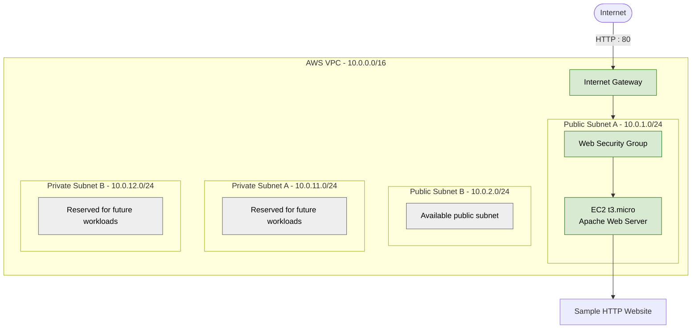

# Terraform AWS Infrastructure Automation

A modular Infrastructure as Code (IaC) project using Terraform to manage AWS networking, security, and compute resources.

## Overview

This project demonstrates reusable Terraform modules, AWS network design, EC2 provisioning, and version control with Git and GitHub.

## Architecture

- **VPC:** `10.0.0.0/16`
- **Public subnets:** Two subnets across Availability Zones.
- **Private subnets:** Two subnets reserved for future private workloads.
- **Internet Gateway:** Internet routing for public subnets.
- **Route tables:** Separate public and private routing configurations.
- **Security group:** Allows inbound HTTP traffic on port 80.
- **EC2:** Runs an Apache web server serving a sample HTML page.

### Architecture Diagram



**Current deployment:** One EC2 instance serves the sample website over HTTP. The other subnets are configured but do not currently host workloads. An Application Load Balancer, Auto Scaling Group, database, NAT Gateway, and HTTPS endpoint are not currently deployed.

## Technologies Used

- Terraform
- Amazon Web Services (AWS)
- Amazon VPC and EC2
- AWS IAM and Security Groups
- AWS CLI
- Git and GitHub
- Windows PowerShell
- GitHub Actions

## Project Structure

```text
terraform-aws-infrastructure-automation/
|-- .github/
|   `-- workflows/
|       `-- terraform-ci.yml
|-- modules/
|   |-- network/
|   |   |-- main.tf
|   |   `-- outputs.tf
|   |-- security/
|   |   |-- main.tf
|   |   `-- outputs.tf
|   `-- compute/
|       |-- main.tf
|       `-- outputs.tf
|-- .gitignore
|-- .terraform.lock.hcl
|-- main.tf
|-- outputs.tf
|-- providers.tf
|-- terraform.tfvars.example
|-- variables.tf
`-- versions.tf
```

## Terraform Modules

### Network

Manages the VPC, public and private subnets, Internet Gateway, route tables, and subnet associations.

### Security

Manages the web server security group and its network access rules.

### Compute

Manages the EC2 instance, instance type, subnet, security group, encrypted root volume, and Apache web server setup.

## Prerequisites

Install Terraform, AWS CLI, and Git. You also need an AWS account with appropriate permissions.

Configure the AWS CLI using a dedicated IAM identity with least-privilege permissions. Avoid using root-user access keys.

## Validate the Configuration

Format Terraform files:

```bash
terraform fmt -recursive
```

Initialize and validate the configuration:

```bash
terraform init
terraform validate
```

Preview proposed infrastructure changes:

```bash
terraform plan
```

Always review a plan before approving an apply. Applying Terraform can create, modify, or destroy billable AWS resources.

## Remote Terraform State

Terraform state is stored remotely in Amazon S3 instead of relying only on a local state file.

**Backend configuration:**
- **Storage:** Amazon S3
- **AWS Region:** `ap-south-1` (Mumbai)
- **State key:** `terraform-aws-infrastructure-automation/terraform.tfstate`
- **Encryption:** S3 server-side encryption using AES-256 (SSE-S3)
- **Versioning:** Enabled to support recovery of previous state-object versions
- **State locking:** S3 lockfile-based locking enabled with `use_lockfile = true`
- **Public access:** S3 Block Public Access enabled

The backend helps protect state, supports recovery, and coordinates Terraform operations that share the same state.

**Important:** Terraform state can contain sensitive infrastructure details. Keep local state backups and saved plan files out of Git, and restrict access to the S3 bucket and state objects.

The backend currently uses the local AWS CLI profile `terraform-dev`. Anyone adapting this configuration should configure their own AWS authentication and backend settings securely before initialization.

## Continuous Integration with GitHub Actions

GitHub Actions automatically checks Terraform configuration changes pushed to the repository.

**Pipeline checks:**

1. **Formatting:** Runs `terraform fmt -check -recursive` to verify consistent Terraform formatting.
2. **Initialization:** Initializes Terraform with the backend disabled for CI validation.
3. **Validation:** Runs `terraform validate` to check Terraform configuration syntax and consistency.
4. **Security scanning:** Uses Checkov to identify potential security misconfigurations in Terraform and AWS resources.

**Security and deployment policy:**

- The workflow performs validation and security scanning only.
- It does not run `terraform apply` or deploy AWS resources.
- It does not require AWS deployment credentials.
- Checkov runs with `--soft-fail`, so security findings can be reported without necessarily failing the workflow.

**Important:** A successful workflow does not mean every security finding has been resolved. Review reported findings and address them according to their risk and the project's cost constraints.

## Security Practices

- Never commit AWS credentials, access keys, passwords, or secrets.
- Keep Terraform state files, saved plans, and local backups out of Git.
- Use least-privilege IAM permissions.
- Encrypt the EC2 root EBS volume.
- Avoid exposing SSH to the entire internet.
- Restrict network traffic to what the workload requires.
- Do not transmit sensitive information through the sample HTTP website.


## Security Scanning and Findings

This project uses Checkov in GitHub Actions to scan Terraform configuration for common AWS security misconfigurations.

The CI security scan currently runs with `--soft-fail` so findings can be reviewed before security policies are made blocking.

### Verified Security Controls

- EC2 root EBS volume encryption is enabled.
- EC2 Instance Metadata Service Version 2 (IMDSv2) is required.
- The EC2 instance uses the `EC2-SSM-Role` instance profile.
- The VPC default security group is restricted.
- The web security group allows inbound HTTP on port 80 and outbound HTTPS on port 443.

### Findings Under Review

The latest local Checkov scan (version 3.3.29) reports 33 passed checks and 8 failed checks, with 0 skipped checks. The scan excludes `CKV_AWS_135` using `--skip-check CKV_AWS_135`. Findings are reviewed individually rather than blindly suppressed.

- **CKV2_AWS_5 - Security group attachment:** Checkov reports that the web security group is not attached to another resource. The Terraform configuration passes `module.security.web_security_group_id` to the compute module, and the EC2 resource uses it in `vpc_security_group_ids`. The live EC2 configuration confirms the intended security group is attached. This finding remains under investigation; no infrastructure change is planned based on this finding alone.
- **CKV_AWS_88 - Public EC2 IP:** The instance has a public IP for direct access to the demonstration website. Revisit this design when evaluating an Application Load Balancer architecture.
- **CKV_AWS_260 - Public HTTP ingress:** Port 80 is intentionally open for the sample website. HTTP traffic is unencrypted; HTTPS is a planned future improvement.
- **CKV_AWS_130 - Public subnet IP assignment:** The two public subnets allow automatic public IP assignment as part of the current public-web-server design. The private subnets do not automatically assign public IPs.
- **CKV_AWS_126 - EC2 detailed monitoring:** Deferred pending cost and monitoring requirements assessment.
- **CKV_AWS_158 - CloudWatch log group encryption:** KMS encryption is under review, including its cost implications.
- **CKV_AWS_338 - CloudWatch log retention:** The Flow Logs group currently uses 14-day retention as a cost-conscious setting rather than the 365-day retention Checkov recommends.
- **CKV_AWS_135 - EBS optimization:** Excluded from the latest local scan using `--skip-check CKV_AWS_135`. The existing instance's optimization status and support were previously investigated; no configuration change has been made.

VPC Flow Logs are enabled and their delivery status has been verified. The CloudWatch log group uses 14-day retention. Findings are reviewed individually, and changes to existing AWS resources are made only after reviewing the Terraform plan and considering availability, security, and cost.

## Cost Considerations

AWS usage is not guaranteed to be free. Check current pricing and your account's Free Tier eligibility before provisioning resources. EC2, public IPv4 addresses, storage, and data transfer may incur charges.

The private subnets do not use a NAT Gateway, avoiding NAT Gateway charges but also providing no NAT-based outbound internet access for private workloads.

Review running resources and AWS billing after testing.

## Future Improvements

- Improve module documentation and variable configuration.
- Explore an Application Load Balancer and Auto Scaling Group.
- Explore a private database tier, HTTPS, monitoring, and alerting.
- Add deployment screenshots to document the project.

## Learning Outcomes

- Infrastructure as Code using Terraform
- Reusable Terraform modules
- AWS VPC and subnet design
- Public and private routing
- EC2 provisioning and web server deployment
- Security group configuration
- Terraform outputs and state-aware refactoring
- Git version control and GitHub
- GitHub Actions for automated Terraform formatting and validation
- S3 remote Terraform state, versioning, encryption, and state locking
- GitHub Actions CI for Terraform formatting, validation, and security scanning
- Checkov findings review and cost-conscious security decisions
