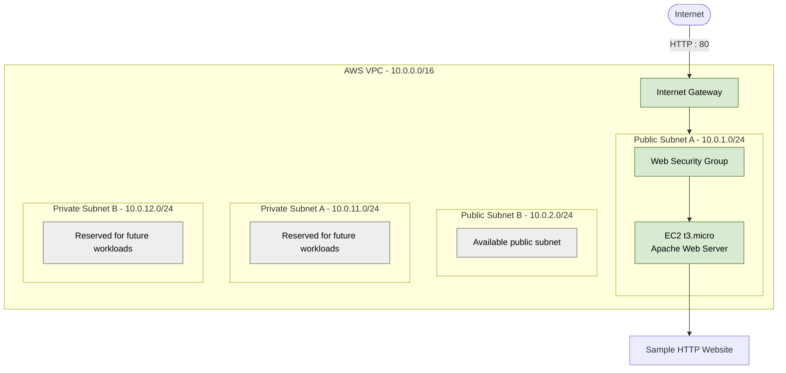

# Terraform AWS Infrastructure Automation

A modular Infrastructure as Code (IaC) project using Terraform to manage AWS networking, security, and compute resources.

## Overview

This project demonstrates reusable Terraform modules, AWS network design, EC2 provisioning, remote state management, security scanning, and version control with Git and GitHub.

## Architecture

- **VPC:** `10.0.0.0/16`
- **Public subnets:** Two subnets across Availability Zones.
- **Private subnets:** Two subnets reserved for future private workloads.
- **Internet Gateway:** Internet routing for public subnets.
- **Route tables:** Separate public and private routing configurations.
- **Security group:** Allows inbound HTTP traffic on port 80 and outbound HTTPS traffic on port 443.
- **EC2:** Runs an Apache web server serving a sample HTML page.

### Architecture Diagram



**Current deployment:** One EC2 instance serves the sample website over HTTP. The other subnets are configured but do not currently host workloads. An Application Load Balancer, Auto Scaling Group, database, NAT Gateway, and HTTPS endpoint are not currently deployed.

## Technologies Used

- Terraform
- Amazon Web Services (AWS)
- Amazon VPC and EC2
- AWS IAM and Security Groups
- AWS CLI
- Git and GitHub
- Windows PowerShell
- GitHub Actions
- Checkov

## Project Structure

```text
terraform-aws-infrastructure-automation/
|-- .github/
|   `-- workflows/
|       `-- terraform-ci.yml
|-- modules/
|   |-- network/
|   |   |-- main.tf
|   |   `-- outputs.tf
|   |-- security/
|   |   |-- main.tf
|   |   `-- outputs.tf
|   `-- compute/
|       |-- main.tf
|       `-- outputs.tf
|-- .gitignore
|-- .terraform.lock.hcl
|-- main.tf
|-- outputs.tf
|-- providers.tf
|-- terraform.tfvars.example
|-- variables.tf
`-- versions.tf
```

## Terraform Modules

### Network

Manages the VPC, public and private subnets, Internet Gateway, route tables, and subnet associations.

### Security

Manages the web server security group and its network access rules.

### Compute

Manages the EC2 instance, instance type, subnet, security group, encrypted root volume, and Apache web server setup.

## Prerequisites

Install the following tools:

- [Terraform](https://developer.hashicorp.com/terraform/install)
- [AWS CLI](https://docs.aws.amazon.com/cli/latest/userguide/getting-started-install.html)
- [Git](https://git-scm.com/downloads)

You also need an AWS account with appropriate permissions.

Configure the AWS CLI using a dedicated IAM identity with least-privilege permissions. Avoid using root-user access keys.

## Validate the Configuration

### 1. Format Terraform files

Format Terraform files when you intentionally want to apply formatting:

```bash
terraform fmt -recursive
```

To check formatting without modifying files:

```bash
terraform fmt -check -recursive
```

### 2. Initialize Terraform

Initialize Terraform locally using your configured AWS credentials and S3 backend:

```bash
terraform init
```

### 3. Validate Terraform configuration

Check the configuration for syntax and internal consistency errors:

```bash
terraform validate
```

### 4. Preview infrastructure changes

Review the proposed changes before making any infrastructure modifications:

```bash
terraform plan
```

**Safety rule:** Review the plan carefully before approving any infrastructure changes. Do not run `terraform apply` or `terraform destroy` without reviewing the proposed actions and explicitly approving them.

In GitHub Actions, initialization uses `terraform init -backend=false -input=false` because the CI job validates the configuration without accessing or modifying remote Terraform state.

## Remote Terraform State

Terraform state is stored remotely in Amazon S3 instead of relying only on a local state file.

**Backend configuration:**

- **Storage:** Amazon S3
- **AWS Region:** `ap-south-1` (Mumbai)
- **State key:** `terraform-aws-infrastructure-automation/terraform.tfstate`
- **Encryption:** S3 server-side encryption using AES-256 (SSE-S3)
- **Versioning:** Enabled to support recovery of previous state-object versions
- **State locking:** S3 lockfile-based locking enabled with `use_lockfile = true`
- **Public access:** S3 Block Public Access enabled

The backend helps protect state, supports recovery, and coordinates Terraform operations that share the same state.

**Important:** Terraform state can contain sensitive information. Never commit state files to GitHub or share them publicly.

## Continuous Integration with GitHub Actions

GitHub Actions automatically checks Terraform configuration changes pushed to the repository.

**Pipeline checks:**

1. **Formatting:** Runs `terraform fmt -check -recursive` to verify consistent Terraform formatting.
2. **Initialization:** Initializes Terraform with the backend disabled for CI validation.
3. **Validation:** Runs `terraform validate` to check Terraform configuration syntax and consistency.
4. **Security scanning:** Uses Checkov to identify potential security misconfigurations in Terraform and AWS resources.

### Security and Deployment Policy

- The workflow performs validation and security scanning only.
- It does not run `terraform apply` or deploy AWS resources.
- It does not require AWS deployment credentials.
- Checkov runs with `--soft-fail`, so security findings can be reported without necessarily failing the workflow.

**Important:** A successful workflow does not mean every security finding has been resolved. Review reported findings and address them according to their risk and the project's cost constraints.

## Security Practices

- Never commit AWS credentials, access keys, passwords, or secrets.
- Keep Terraform state files, saved plans, and local backups out of Git.
- Use least-privilege IAM permissions.
- Encrypt the EC2 root EBS volume.
- Require IMDSv2 for EC2 instance metadata access.
- Avoid exposing SSH to the entire internet.
- Restrict network traffic to what the workload requires.
- Do not transmit sensitive information through the sample HTTP website.
- Review Terraform plans before approving infrastructure changes.
- Check AWS billing and resource usage during and after testing.

## Security Scanning and Findings

This project uses Checkov 3.3.29 to scan Terraform configuration for common AWS security misconfigurations. The GitHub Actions workflow also runs security scanning with `--soft-fail`, so findings are reported for review without necessarily failing the workflow.

### Latest Local Scan

| Result | Count |
|---|---:|
| Passed | 35 |
| Failed | 7 |
| Skipped | 0 |

Run the scan locally using:

```powershell
checkov -d . --framework terraform --compact
```

### Verified Security Controls

- EC2 root EBS volume encryption is enabled.
- EC2 Instance Metadata Service Version 2 (IMDSv2) is required.
- The EC2 instance uses the `EC2-SSM-Role` instance profile.
- The VPC default security group is restricted.
- The web security group allows inbound HTTP on port 80 and outbound HTTPS on port 443.
- VPC Flow Logs are enabled with a 14-day CloudWatch Logs retention period.

### Findings and Risk Decisions

The following seven findings remain in the latest recorded local scan. Decisions account for security, the existing deployment, and cost.

| Check ID | Finding | Current decision |
|---|---|---|
| `CKV_AWS_126` | EC2 detailed monitoring disabled | Deferred pending monitoring and cost review |
| `CKV_AWS_135` | EC2 EBS optimization | Deferred because enabling it previously proposed replacing the existing instance |
| `CKV_AWS_88` | EC2 has a public IP | Retained for the current public web-server design |
| `CKV_AWS_158` | CloudWatch Logs customer-managed KMS key | Deferred pending encryption and cost review |
| `CKV_AWS_338` | Log retention below 365 days | Retained at 14 days to limit storage costs |
| `CKV_AWS_260` | Public HTTP ingress on port 80 | Retained for the current demonstration; HTTP does not encrypt traffic |
| `CKV2_AWS_5` | Security-group attachment not detected by Checkov | Terraform configuration, Terraform state, and live AWS inspection confirm attachment; likely cross-module static-analysis limitation |

These decisions document the current trade-offs; they do not mean every finding has been fixed or that the current architecture is suitable for production.

### Infrastructure Safety

- `terraform fmt -check -recursive` completed successfully.
- `terraform validate` completed successfully.
- The latest `terraform plan -no-color` reported no changes.
- No `terraform apply` or `terraform destroy` was performed during this review.
- The existing EC2 instance and its `user_data` configuration were preserved.
- Changes that could replace or disrupt the existing instance were not applied.

### Future Security Improvements

- Consider HTTPS through a public Application Load Balancer and a private EC2 instance.
- Reassess monitoring and log-retention requirements against budget and operational needs.
- Investigate the Checkov security-group graph finding further.
- Review the Terraform plan before approving infrastructure changes.

## Cost Considerations

AWS usage is not guaranteed to be free. Check current pricing and your account's Free Tier eligibility before provisioning resources. EC2, public IPv4 addresses, storage, logging, and data transfer may incur charges.

The private subnets do not use a NAT Gateway, avoiding NAT Gateway charges but also providing no NAT-based outbound internet access for private workloads.

Review running resources and AWS billing after testing. Do not enable additional services solely to make Checkov pass without assessing their cost and operational value.

## Future Improvements

- Improve Terraform module documentation, input variables, and output descriptions where needed.
- Evaluate an Application Load Balancer (ALB) and Auto Scaling Group (ASG) in a cost-conscious architecture.
- Explore a private database tier and HTTPS using an appropriate architecture and security review.
- Assess monitoring, alerting, and log-retention requirements against operational needs and budget.
- Investigate the Checkov security-group attachment finding and review the remaining security findings.
- Add architecture diagrams, successful CI results, and deployment evidence to document project milestones.
- Review every proposed Terraform plan before approving infrastructure changes.

## Learning Outcomes

- Infrastructure as Code using Terraform
- Reusable Terraform modules
- AWS VPC and subnet design
- Public and private routing
- EC2 provisioning and web server deployment
- Security group configuration
- Terraform outputs and state-aware refactoring
- Git version control and GitHub
- GitHub Actions CI for Terraform formatting, validation, and security scanning
- S3 remote Terraform state, versioning, encryption, and state locking
- Checkov security findings review and cost-conscious infrastructure decisions
- Least-privilege IAM and AWS infrastructure security practices
